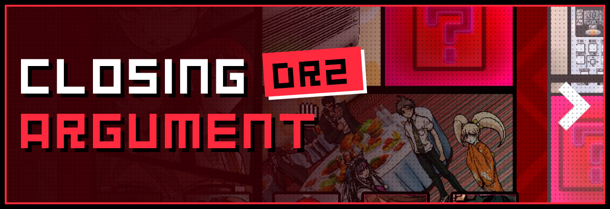
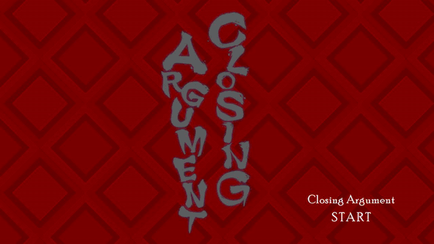
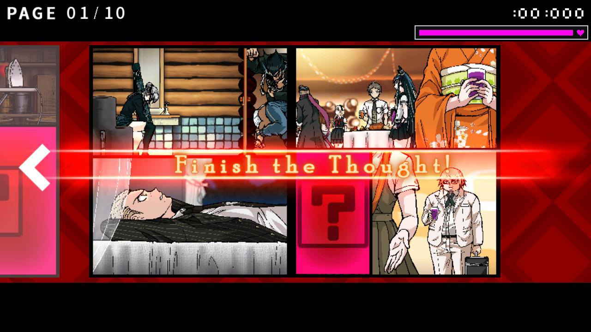
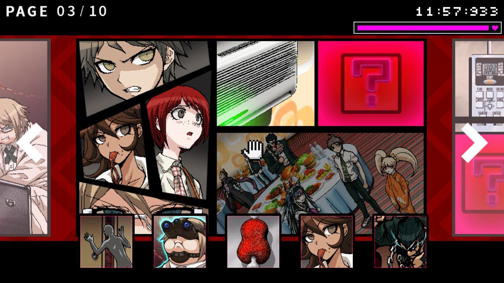
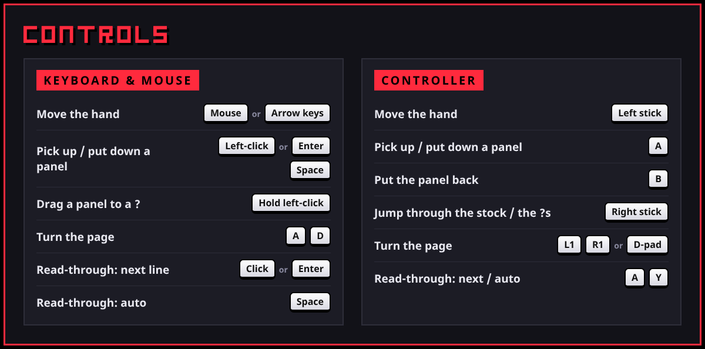
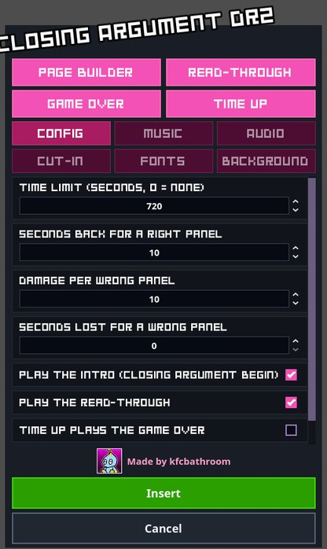
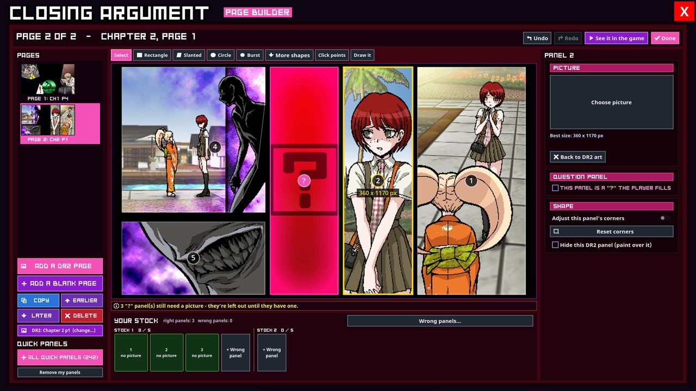
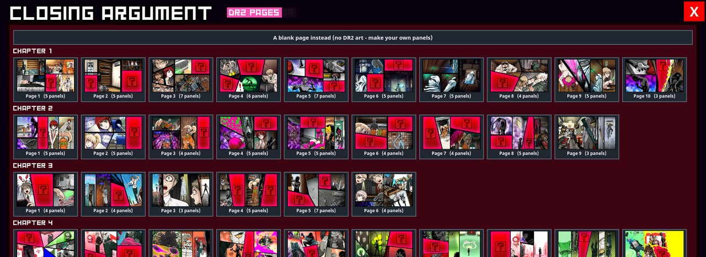
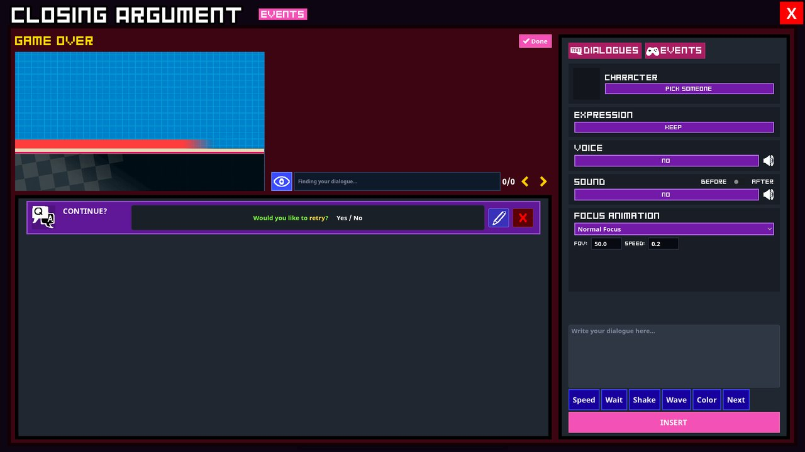

  

  
  
  

  

  

---

## 🧩 What is it?

**Closing Argument DR2** is Danganronpa 2's manga-style Closing Argument for your Danganmake trials. The crime is told as manga pages with missing **"?"** panels. Grab a panel from the stock under the page, drop it into its "?", and turn the pages until the whole story is complete. Then the finished manga plays back as a read-through.

It comes with Chapter 1 ready to play, and a Page Builder with every DR2 page from Chapters 1 to 5 so you can make your own.

## ✨ Features

- 📖 **DR2-style manga pages.** The *"Closing Argument / BEGIN"* intro, the stock that comes in waves, the timer, health, hints and *"Finish the Thought!"*.
- 🎬 **Read-through at the end.** The completed manga plays back with subtitles, voice lines, sounds and effects.
- 🛠️ **Page Builder.** Start from any of DR2's own pages, or draw your own panels: rectangles, slanted, circles, bursts or your own shape. Set the "?"s, the stock and the wrong panels.
- 🎞️ **Read-through editor.** Premiere-style keyframes, ready-made motions, effects, and a timeline window with snapping clips.
- 💀 **Game Over and Time Up events.** Built with Danganmake's own dialogue editor: lines, music, HUD, character sprites and the *"Would you like to retry?"* question.
- 🎮 **Controller support.** Move the hand, jump through the stock and the "?"s, pick up and put down panels.
- 🔊 **Danganmake's characters and sounds.** Voices and sounds are picked from Danganmake's own menus.

## 📸 Screenshots

<table>
  <tr>
    <td width="50%"></td>
    <td width="50%"></td>
  </tr>
  <tr>
    <td align="center">Find the "?" on the page</td>
    <td align="center">Drop the right panel from the stock into it</td>
  </tr>
</table>

## 📥 How to install

Don't have Danganmake yet? **[Get it on itch.io](https://freddysdarkon.itch.io/danganmake)**.

1. Go to the **[Releases page](https://github.com/kfcbathroom25/danganmake-closingargumentdr2/releases/latest)** and download the latest `.zip`.
2. Unzip it.
3. Drop the folders inside into your Danganmake **mods assets** folder.
4. That's it! **Closing Argument DR2** now shows up in Danganmake's minigames.

> [!TIP]
> When a new version comes out, download it the same way and replace the old folders.

## 🎮 Controls

  

Controls as text

| Action | Keyboard & mouse | Controller |
| --- | --- | --- |
| Move the hand | Mouse / arrow keys | Left stick |
| Pick up / put down a panel | Left-click / Enter / Space | A |
| Drag a panel to a "?" | Hold left-click | - |
| Put the panel back | - | B |
| Jump through the stock / the "?"s | - | Right stick |
| Turn the page | A / D | L1 / R1 or D-pad |
| Read-through: next line / auto | Click, Enter / Space | A / Y |

## 🖌️ Make your own case

Insert the minigame in Danganmake's editor and its settings open:

<table>
  <tr>
    <td width="32%" valign="top"></td>
    <td valign="top">
      <ul>
        <li><b>Page Builder:</b> build the manga pages, "?"s and stock.</li>
        <li><b>Read-Through:</b> the playback when the manga is complete.</li>
        <li><b>Game Over / Time Up:</b> what happens when health or time runs out.</li>
        <li><b>Config / Music / Audio / Cut-in / Fonts / Background:</b> time limit, seconds won or lost per panel, damage, intro, songs and more.</li>
      </ul>
      
Press <b>Insert</b> to save it into your trial.

    </td>
  </tr>
</table>

### 📐 Page Builder

The Page Builder is where you make the comic yourself: the pages, their panels, which panels are a **"?"**, and what the player gets to put in them.

**Start a page.** Press **Add a DR2 page** to start from any page of DR2's Chapters 1 to 5, with its art, panels and "?"s already in place, or **Add a blank page** to draw everything yourself.

**Build it, step by step:**

1. **Draw your panels** with the tools above the page: **Rectangle**, **Slanted**, **Circle**, **Burst**, **More shapes**, **Click points** (a shape of your own, corner by corner) or **Draw it** (freehand). Drag a panel to move it, and use its corners to reshape it.
2. **Click a panel** to set it up on the right: give it a **picture**, tick **This panel is a "?" the player fills**, or adjust its corners.
3. **Fill the stock.** Every "?" panel goes into **Your stock**, the panels the player picks from. In DR2 the stock comes in **waves of up to five**, and you can add **wrong panels** to make it harder.
4. **Use Quick panels** to drop in ready-made pictures from the game (242 of them), or add your own.
5. **Order the pages** with **Copy**, **Earlier**, **Later** and **Delete**. Undo and Redo work everywhere.
6. Press **See it in the game** to play it right away, then **Done**.

> [!NOTE]
> A "?" panel without a picture is left out of the puzzle until it has one. The yellow line under the page tells you what's still missing.

### Game Over / Time Up

The same editor Danganmake uses for dialogue. Add lines, change the music or HUD, set someone's sprite, and place the **CONTINUE?** question.

## 🐞 Found a bug?

**[Report it here](https://github.com/kfcbathroom25/danganmake-closingargumentdr2/issues/new?template=bug_report.yml)**. A short form asks what happened and how to make it happen again. Screenshots or a video help a lot.

## 🎲 More minigames

| Minigame | |
| --- | --- |
| **[Closing Argument V3](https://github.com/kfcbathroom25/danganmake-closingargumentv3)** | V3's comic-book Closing Argument: rebuild the case one panel at a time. |
| **[Spot Selection DR2](https://github.com/kfcbathroom25/danganmake-spotselectiondr2)** | DR2's "Select a Suspicious Spot!": find what's wrong in the picture. |

**[See every minigame by kfcbathroom](https://github.com/kfcbathroom25?tab=repositories&q=danganmake-&type=source)**

## 💬 Credits

- **kfcbathroom**: Closing Argument DR2 minigame
- **[Power2015](https://github.com/Power2015Dev)** and **[FreddysDark-on](https://github.com/FreddysDark-on)**: Danganmake and the minigame template
- [Danganmake documentation](https://power2015dev.github.io/Danganmake-Engine/content.html)

Danganronpa is © Spike Chunsoft. This is a fan-made minigame and is not affiliated with Spike Chunsoft.
